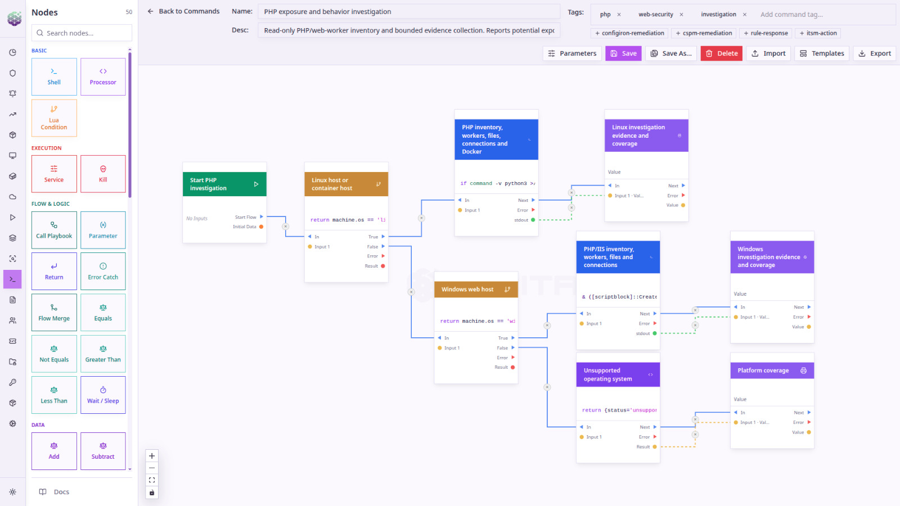

# php2shell — CVE-2026-109618 / CVE-2026-109619 · ORBITRON response kit

> **Status: v1.2.3 — PRE-DISCLOSURE (2026-10-21 14:55 TRT / 11:55 UTC).**
> The official PHP advisory with technical details, affected and fixed versions is scheduled for
> **2026-10-21 14:00 UTC (17:00 TRT)**. This repository will be updated after the release.
> Everything marked *reported* or *unconfirmed* below may change. Check [CHANGELOG.md](CHANGELOG.md).
>
> Türkçe sürüm: [README.tr.md](README.tr.md)

## TL;DR

* Two critical remote code execution bugs in PHP core, both rated CVSS v4.0 9.2 by the PHP security team.
  Details leaked early; the fix ships on **21 Oct 2026, 14:00 UTC** (or earlier if exploitation starts).
* Public PoC/exploit: none confirmed. Several "exploit" repositories appeared on GitHub on 21 Oct —
  **unverified, do not run them outside an isolated lab.**
* **Patching is the only fix.** `session.upload_progress.enabled=0` is, according to its own authors'
  update, only a *partial* mitigation.
* Detection before disclosure can only be **behavioural** (post-exploitation). This kit gives you
  inventory scripts and rules for Sigma, Splunk, QRadar, CrowdStrike Falcon, SentinelOne, Wazuh,
  YARA and ModSecurity — all clearly labelled with what they do and do not cover.

## 1. What happened?

| Item | Status |
|---|---|
| Two critical PHP security bugs, CVSS v4.0 9.2 each, release 21 Oct 2026 14:00 UTC | **Confirmed** by php.net (advance notice of 20 Oct) |
| Bug class: remote code execution in PHP core, unauthenticated | Reported by watchTowr (reproduced CVE-2026-109618) and others; PHP has not published details |
| CVE IDs CVE-2026-109618 / CVE-2026-109619 | From watchTowr and the leaked material; the php.net notice does not name them; records are reserved |
| Nickname "php2shell", exploit tool "PHP2Shell" claiming PHP ≥ 5.4 | Reported (screenshot leak) — unconfirmed |
| Affected versions "PHP 5 through 8" | Reported — **unconfirmed** |
| Fixes for supported branches only (8.2, 8.3, 8.4, 8.5) | Reported; consistent with PHP's support policy |
| Link to *Session Upload Progress* (`ext/session`), memory corruption | GMO Flatt Security's assessment, *conditional on* their own research matching php2shell |
| Exploitation in the wild | None reported as of 21 Oct morning (watchTowr, Huntress) |

Timeline: 20 Oct ~15:20 UTC a Hacker News post leaks the upcoming disclosure → 20 Oct 19:33 UTC PHP
publishes the advance notice → 21 Oct 14:00 UTC scheduled release.

## 2. Why it matters

* PHP runs a large share of the public web: WordPress/WooCommerce, Magento/Adobe Commerce, Shopware,
  Drupal, Laravel/Symfony apps, hosting control panels and many appliances that bundle PHP.
* A core-interpreter RCE is reachable through *any* application on the affected runtime — application
  hardening and application-level WAF plugins run *after* PHP has processed the request.
* Researchers (e.g. Sansec) expect mass exploitation within minutes of the release, because the patch
  diff reveals the bug.
* Large end-of-life population: internet scans count hundreds of thousands of hosts advertising PHP 8.1
  or older, which will not receive an upstream fix.

## 3. Affected systems — what we know now

| Runtime | Expected situation (pending advisory) |
|---|---|
| PHP 8.2 / 8.3 / 8.4 / 8.5 from php.net, Remi, deb.sury.org, official Docker images, Windows builds | Upstream fix expected 21 Oct 14:00 UTC |
| PHP 8.1 and older (upstream EOL) | **No upstream fix.** Only distribution/ESM/vendor backports or an upgrade |
| Distribution packages (RHEL/Rocky/Alma, Debian, Ubuntu, SUSE) | Fix arrives via the distribution's security process — timing differs, see §7 |
| All SAPIs (mod_php, PHP-FPM, CGI/FastCGI, LiteSpeed) | Reported reproductions include mod_php and php-fpm with WordPress/Laravel/Symfony (per Flatt Security's summary of the researcher post) |

## 4. What to check (use the scripts)

| Script | Platform | What it does |
|---|---|---|
| [`scripts/linux/php2shell-check.sh`](scripts/linux/php2shell-check.sh) | Linux (RHEL family, Debian/Ubuntu, Alpine, cPanel/Plesk/CloudLinux/Remi paths) | Finds every PHP binary and SAPI, reads the **effective** settings per SAPI (CLI, FPM, CGI, mod_php ini set), lists FPM-pool / web-server / `.user.ini` / `.htaccess` overrides, owning package + origin (distro, Remi, Sury), whether the package changelog already lists the CVEs, running processes, **whether the running FPM workers / Apache children were started after the last config change and still run the current binary** (`LOADED` / `STALE` / `RESTART REQUIRED`), and **PHP inside containers / Kubernetes pods on the host** (Docker, Podman, containerd, CRI-O) inspected read-only via `/proc/<pid>/root` — version, package, `session.upload_progress` and running state per container, with pod/container names when `crictl`/`docker`/`podman` is available |
| [`scripts/windows/php2shell-check.ps1`](scripts/windows/php2shell-check.ps1) | Windows (IIS FastCGI, XAMPP, WAMP, Laragon, Plesk, PATH, running processes) | Same for Windows; evaluates each IIS FastCGI application with its own arguments/`PHPRC`, and checks whether running `php-cgi.exe` / Apache processes predate the last `php.ini` change or the PHP binary (incl. IIS `monitorChangesTo`) |

Both are **read-only**, make no network connections and do not attempt exploitation. JSON output for
fleet collection (e.g. via ORBITRON Command Engine, Ansible, SCCM/Intune).

```bash
sudo bash php2shell-check.sh                 # human readable
sudo bash php2shell-check.sh -o report.json  # + JSON
sudo bash php2shell-check.sh --no-containers   # skip the (read-only) container / pod inspection
sudo bash php2shell-check.sh --container-exec  # additionally run 'php -r' via docker/podman exec for exact CLI values
```
```powershell
powershell -ExecutionPolicy Bypass -File .\php2shell-check.ps1 -OutFile report.json
```
Exit codes: `0` no PHP, `1` PHP found and all runtimes confirmed patched, `2` PHP found and at least
one runtime **not confirmed** patched.

After the advisory is published set the fixed versions (only from php.net):
`PHP2SHELL_FIXED_UPSTREAM="8.2.x 8.3.x 8.4.x 8.5.x"` (Linux env var / Windows env var). The Linux script
does **not** apply upstream version comparison to distribution packages that backport fixes
(RHEL/Ubuntu keep old version numbers) — for those it relies on the package changelog listing the CVE.

Checklist:
1. Inventory every PHP runtime **and the SAPI the web server actually uses** (CLI values ≠ FPM values).
2. Flag upstream-EOL branches (≤ 8.1) that are not covered by a distribution/ESM backport.
3. Record where your packages come from (distro, Remi, Sury, panel vendor) — that decides *when* you can patch.
4. Prioritise internet-facing hosts; prepare change windows for 21 Oct after 14:00 UTC.
5. Check that FPM pools / containers are **restarted** after updating (a running worker keeps the old binary).
   The settings above are read from the ini files on disk; the `Running:` line shows whether the running
   processes actually use them. `STALE` = reload needed, `RESTART REQUIRED` = processes still run a binary that
   was replaced by a package update.

## 5. Known workarounds — current status

| Workaround | Status (21 Oct, 10:30 TRT) | Notes |
|---|---|---|
| `session.upload_progress.enabled = 0` | **Partial mitigation only.** Flatt Security, who proposed it, updated their post: attack is expected to remain possible. PHP core developers are quoted as saying INI settings alone will not protect. One analysis claims it covers only one of the two bugs. | Low cost: uploads keep working, only progress tracking stops. It is `INI_PERDIR`: set in php.ini, FPM pool (`php_admin_flag`), Apache `php_admin_flag` — **not** via `ini_set()`. Verify the effective value per SAPI with the script. |
| `session.use_strict_mode = 1` | **Not a mitigation for this mechanism** (our lab, see §9) | Still good hygiene. |
| WAF rule on the `PHP_SESSION_UPLOAD_PROGRESS` multipart field | **Hunting / one vector only** | Lab-tested ModSecurity rules in `rules/modsecurity/`. Blocking variant is disabled by default. |
| Restrict exposure (VPN/IP allow-list, take admin panels offline, isolate EOL hosts) | Effective risk reduction | CERT-EU advises isolating internet-facing applications until fixed. |
| Least privilege for the PHP user, egress filtering, read-only web roots | Limits impact | Recommended by Flatt Security; also reduces webshell persistence. |
| Patch | **The fix** | 21 Oct 14:00 UTC upstream; distribution timing see §7. |

## 6. Detection & monitoring rules

No exploit signature can be written before the patch diff is public. The rules below detect what an
attacker does *after* PHP code execution, plus hunting signals around the suspected mechanism.
**All SIEM/EDR queries are UNTESTED on live platforms** (generated with pySigma from the Sigma sources);
YARA, ModSecurity and the scripts were tested in our lab. Baseline 1–2 h before alerting.

| Use case | Sigma (source) | Splunk | QRadar | CrowdStrike Falcon | SentinelOne | Wazuh | Other |
|---|---|---|---|---|---|---|---|
| Linux: PHP/web server spawns shell, interpreter, download/recon tool | `lnx_..._spawns_shell_or_lolbin.yml` | `.spl`, `.cim.spl` | `.aql`, `.payload.aql` | `.logscale` | `.dv`, `.pq` | 109610–109612 (auditd) | — |
| Linux: reverse-shell / recon command line from PHP | `lnx_..._suspicious_cmdline.yml` | ✓ | ✓ | ✓ | ✓ | 109613 | — |
| Windows: php-cgi/php/httpd/w3wp spawns shell/LOLBin | `win_..._spawns_shell_or_lolbin.yml` | ✓ | ✓ | ✓ | ✓ | 109620 (Sysmon) | — |
| Webshell / `.user.ini` / `.htaccess` written to web root | `lnx_/win_..._file_written_to_webroot.yml` | ✓ | ✓ | use Falcon built-in webshell detections | ✓ | 109615, 109616, 109621 | YARA |
| PHP worker crash (SIGSEGV/SIGABRT) — memory-corruption attempts | `php2shell_php_worker_crash.yml` | ✓ | payload | ✓ (needs log ingestion) | — | 109625, 109626 | — |
| Upload-progress field in multipart requests | — | — | — | — | — | — | ModSecurity 9109618/19/21 (+ blocking 9109620) |
| Webshells, auto_prepend persistence, upload-progress session leftovers | — | — | — | — | — | — | YARA `rules/yara/` |

Data requirements: process creation with parent image (Sysmon for Linux/Windows, auditd `execve`,
EDR), file creation telemetry for the web-root rules, PHP-FPM/Apache error logs for the crash rule,
request-body inspection for ModSecurity. Platform notes:

* **Splunk** — `.spl` uses Sysmon field names (`Image`, `ParentImage`, `CommandLine`), `.cim.spl` uses the CIM Endpoint data model.
* **QRadar** — field-based `.aql` needs Sysmon/EDR custom properties (*Parent Process Path*, *Command*); Linux OS DSM (auditd) usually lacks parent process → use `.payload.aql` or the Wazuh/auditd approach.
* **CrowdStrike Falcon** — LogScale / NG-SIEM / Advanced Event Search syntax on `ProcessRollup2`; file-write rules not generated (pipeline limitation).
* **SentinelOne** — `.dv` (Deep Visibility) keeps `endswith`; the `.pq` backend approximates `endswith` with `contains` (broader).
* **Wazuh** — `rules/wazuh/0910-orbitron-php2shell_rules.xml` + `auditd-php2shell.rules` + `ossec-agent-snippet.xml`. Validate with `wazuh-logtest`.
* **YARA** — `yara -r rules/yara/php2shell_hunting.yar /var/www` and the PHP session directory.
* Rebuild platform queries: `python3 tools/build_rules.py` (see `rules/BUILD_REPORT.md`).

Expected false positives: PHP apps that legitimately `exec()` (image/PDF tools, backups, deploy hooks,
control panels), PHP `mail()` (`sh -c sendmail`, filtered), CMS self-updates writing `.php` files,
crashing third-party extensions.

## 7. Patch timeline and how updates reach each platform

| Source | How the fix arrives | What to expect / how to verify |
|---|---|---|
| **php.net (upstream)** | New point releases for 8.2–8.5 on 21 Oct 14:00 UTC (or earlier) | Version number is the indicator (fixed versions published with the advisory) |
| **Windows** (windows.php.net builds, XAMPP/WAMP/Laragon, IIS) | Replace PHP binaries with the new build; repackaged stacks follow later | `php -v`; restart IIS app pools / Apache |
| **Remi (RHEL family) / deb.sury.org & ondrej PPA (Debian/Ubuntu)** | Track upstream releases and usually publish new upstream versions quickly | Upstream version number applies; `dnf update` / `apt upgrade`, restart FPM |
| **RHEL 8/9/10 → Rocky / AlmaLinux / Oracle** | Red Hat **backports** the fix into the existing package (version number does *not* change); Rocky/Alma rebuild the RHSA (Rocky's RLSA notices are mirrored from RHSA) | Historically not same-day: e.g. the May 2026 PHP fixes reached RHEL as RHSA-2026:22143 (php:8.2, RHEL 9, dated 20 Jul) and Rocky 8 as RLSA-2026:34354 (2 Jul). Check `dnf updateinfo list --cve CVE-2026-109618` and `rpm -q --changelog php-common \| grep CVE-2026-10961` |
| **Debian** | Debian Security Team releases a DSA; for PHP it has recently shipped the new upstream point release (e.g. DSA-6255-1 → `8.2.31-1~deb12u1`, the day after upstream) | `apt list --upgradable 'php*'`; security-tracker.debian.org |
| **Ubuntu** | USN with **backported** patches (keeps e.g. `8.3.6-0ubuntu0.24.04.x`); older releases via Ubuntu Pro/ESM | Past PHP USNs arrived days to weeks after upstream (e.g. USN-8564-1, 20 Jul). Check ubuntu.com/security/CVE-… and the changelog |
| **Containers** (official `php:` images, custom images) | Images are rebuilt after upstream release | Rebuild **and redeploy**; pinned base images will not update themselves |
| **Hosting panels / CloudLinux / appliances** (cPanel EA-PHP, Plesk, alt-php, vendors) | Vendor-specific | Ask the vendor/hosting provider *today* to stand by |
| **Upstream EOL (≤ 8.1)** | No upstream fix | Upgrade, vendor/ESM backport, or isolate |

In every case: **restart PHP-FPM / Apache / IIS app pools** after updating and re-run the checker.

## 8. Recommended plan for today

1. Now: run the inventory scripts, list internet-facing PHP, EOL branches and package sources.
2. Now: enable the behavioural rules (process, file, crash) in your SIEM/EDR; enable ModSecurity rules in log mode.
3. Now: set `session.upload_progress.enabled=0` where progress bars are not used — as risk reduction, not as a fix.
4. Now: ask hosting/panel/appliance vendors and distribution channels for their release plan.
5. 14:00 UTC: read the advisory, set `PHP2SHELL_FIXED_UPSTREAM`, patch upstream-tracking hosts first, restart services.
6. Until distribution packages arrive: restrict exposure of RHEL/Ubuntu-packaged PHP, watch the rules closely.
7. Afterwards: hunt for webshells (YARA), new `.user.ini`/`.htaccess`, new cron jobs and accounts on hosts that were exposed.

## 9. Lab notes (ORBITRON, Ubuntu 24.04, PHP 8.3.6, mod_php and built-in server)

We tested the *mechanism* Flatt Security points to — not the vulnerability:
* A multipart request containing a field named `PHP_SESSION_UPLOAD_PROGRESS` made PHP create a session
  file **even though the target script never calls `session_start()`**, using the session ID chosen by
  the client (`session.use_strict_mode=Off`).
* With `session.use_strict_mode=On` PHP still wrote the progress data, under a random ID → strict mode
  does not stop the mechanism.
* With `session.upload_progress.enabled=0` no session file was created.
* With the default `session.upload_progress.cleanup=On` the session file remained as an empty file.
* A request to a non-existent `.php` path (404) did not trigger it — any *reachable* PHP script does.
* ModSecurity 2.9: log rules fired only for multipart requests carrying the field; normal uploads were
  not flagged; the blocking variant returned 403.

## 10. References

* PHP — Upcoming Critical PHP Security Release (20 Oct 2026): https://www.php.net/archive/2026.php#2026-10-20-1
* GMO Flatt Security — php2shell overview and guidance (JA, updated 21 Oct): https://blog.flatt.tech/entry/php2shell
* Sansec — Critical PHP RCE: https://sansec.io/research/php2shell
* Huntress — Rapid Response: https://www.huntress.com/blog/php2shell-leaked-critical-php-vulnerabilities
* The Hacker News: https://thehackernews.com/2026/10/php2shell-two-unpatched-critical-php.html
* Phoenix Security: https://phoenix.security/php-core-rce-cve-2026-109618-109619-critical-remote-code-execution/
* PHP manual — Session Upload Progress: https://www.php.net/manual/en/session.upload-progress.php
* Red Hat RHSA-2026:22143 · Rocky RLSA-2026:34354 · Debian DSA-6255-1 · Ubuntu USN-8564-1 (patch-latency data points)

## 11. Running it from ORBITRON

ORBITRON customers can run the same investigation as a ready-made command playbook,
*PHP exposure and behavior investigation*: read-only PHP / web-worker inventory and bounded
evidence collection across the fleet.



The playbook branches on the host OS. Linux hosts and container hosts collect PHP inventory,
workers, files, connections and Docker; Windows web hosts collect PHP/IIS inventory, workers,
files and connections. Each branch returns its evidence and a coverage report, and unsupported
operating systems are reported as such, so gaps stay visible.

The scripts in `scripts/` are standalone and do not require ORBITRON.

## Disclaimer & license

Provided as-is for defensive use, without warranty. Validate scripts and rules in your environment
before production use. No exploit code is or will be published here. Scripts and rules: MIT License
(see [LICENSE](LICENSE)). © 2026 ORBITRON.
